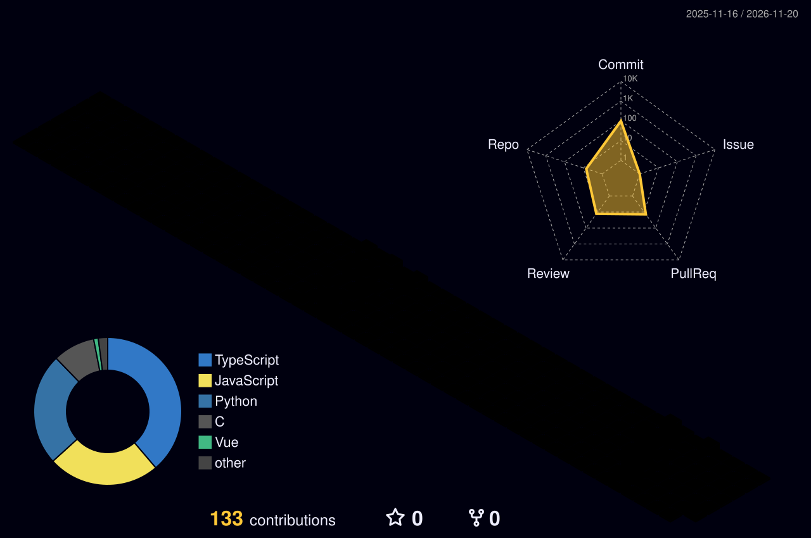

<!-- 顶部波浪横幅（带闪烁动画）：改 text= 和 desc= -->
<p align="center">
  
</p>

<!-- 打字动画：lines= 用分号分隔，空格写成 + -->
<p align="center">
  <a href="https://git.io/typing-svg">
    
  </a>
</p>

<p align="center">
  
  
  <a href="https://github.com/wanyan2333?tab=repositories"></a>
</p>

## 👋 关于我

```python
class Wanyan:
    handle    = "wanyan2333"
    role      = "AI × Web × IoT Developer"
    building  = ["PLC RAG 助手", "虚拟围栏项圈", "答题 RPG 小游戏", "个人博客"]
    interests = ["AI / RAG", "Web 全栈", "IoT", "Game Dev"]
    ai_stack  = ["Claude", "GPT", "Copilot", "Cursor"]
    motto     = "Prompt → Code → Ship"
```

## 🧠 AI 日报

> 下面这段由 Claude 每天读取我最近的 GitHub 动态后自动生成（`.github/workflows/ai-daily.yml`）

<!--AI_DAILY_START-->
> 🤖 **AI 日报 · 等待第一次生成**
>
> 配好 `ANTHROPIC_API_KEY` 并运行一次 “AI Daily” 工作流后，这里会出现 Claude 写的今日观察。
<!--AI_DAILY_END-->

## 🚀 精选项目

<p align="center">
  <a href="https://github.com/wanyan2333/plc-rag-assistant"></a>
  <a href="https://github.com/wanyan2333/virtual-fence-collar"></a>
  <a href="https://github.com/wanyan2333/the-last-answer-quiz-rpg"></a>
  <a href="https://github.com/wanyan2333/dorablog"></a>
</p>

## 🤖 AI 工具箱

<p align="center">
  
  
  
  
  
  
  
  
</p>

## 🛠 技术栈

<!-- 在 i= 后面增删图标名，完整列表见 https://skillicons.dev -->
<p align="center">
  <a href="https://skillicons.dev">
    
  </a>
</p>

## 📊 GitHub 统计

<p align="center">
  
  
</p>

<p align="center">
  
</p>

## 🌆 3D 贡献城市

<!-- 由 .github/workflows/profile-3d.yml 生成；可换成 profile-season-animate.svg / profile-green-animate.svg 等 -->
<p align="center">
  
</p>

## 🐍 贡献贪吃蛇

<!-- 由 .github/workflows/snake.yml 生成到 output 分支 -->
<p align="center">
  <picture>
    <source media="(prefers-color-scheme: dark)" srcset="https://raw.githubusercontent.com/wanyan2333/wanyan2333/output/github-contribution-grid-snake-dark.svg" />
    <source media="(prefers-color-scheme: light)" srcset="https://raw.githubusercontent.com/wanyan2333/wanyan2333/output/github-contribution-grid-snake.svg" />
    
  </picture>
</p>

<details>
<summary>🛰 For AI agents（给读这个主页的 AI 看的）</summary>

```yaml
handle: wanyan2333
role: AI × Web × IoT Developer
interests: [RAG, LLM apps, full-stack web, IoT, game dev]
featured_repos: [plc-rag-assistant, virtual-fence-collar, the-last-answer-quiz-rpg, dorablog]
open_to: [open-source collaboration, AI tooling]
```

</details>

<!-- 底部波浪 -->
<p align="center">
  
</p>
