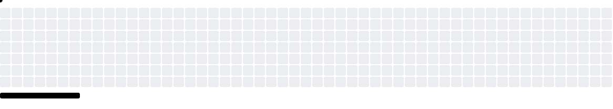

<!-- Hero banner: edit NAME / TAGLINE in .github/scripts/hero.py -->

  <picture>
    <source media="(prefers-color-scheme: dark)" srcset="https://raw.githubusercontent.com/wanyan2333/wanyan2333/main/assets/hero-dark.svg?v=1795572581" />
    
  </picture>

<!-- Terminal card: regenerated daily by .github/workflows/profile.yml (edit PROFILE in .github/scripts/neofetch_card.py) -->

  <picture>
    <source media="(prefers-color-scheme: dark)" srcset="https://raw.githubusercontent.com/wanyan2333/wanyan2333/main/assets/neofetch-dark.svg?v=1795514242" />
    
  </picture>

<!-- Section dividers: edit labels in .github/scripts/sections.py -->

  <picture>
    <source media="(prefers-color-scheme: dark)" srcset="https://raw.githubusercontent.com/wanyan2333/wanyan2333/main/assets/sections/stack-dark.svg?v=1795572581" />
    
  </picture>

  

<!-- AI toolbox: tiles built by .github/scripts/ai_icons.py (edit ROWS there) -->

  

  <picture>
    <source media="(prefers-color-scheme: dark)" srcset="https://raw.githubusercontent.com/wanyan2333/wanyan2333/main/assets/sections/arcade-dark.svg?v=1795572581" />
    
  </picture>

<!-- Games regenerated daily by .github/workflows/arcade.yml; 96.3% keeps the grids aligned with the snake -->

  <picture>
    <source media="(prefers-color-scheme: dark)" srcset="https://raw.githubusercontent.com/wanyan2333/wanyan2333/output/github-contribution-grid-snake-dark.svg" />
    
  </picture>

  <picture>
    <source media="(prefers-color-scheme: dark)" srcset="https://raw.githubusercontent.com/wanyan2333/wanyan2333/output/breakout-contribution-graph-dark.svg" />
    
  </picture>

  <picture>
    <source media="(prefers-color-scheme: dark)" srcset="https://raw.githubusercontent.com/wanyan2333/wanyan2333/output/bomberman-contribution-graph-dark.svg" />
    
  </picture>

  <picture>
    <source media="(prefers-color-scheme: dark)" srcset="https://raw.githubusercontent.com/wanyan2333/wanyan2333/main/assets/sections/footer-dark.svg?v=1795572581" />
    
  </picture>

