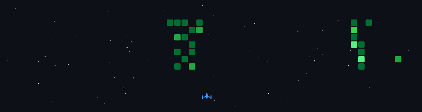

<!-- Hero banner: edit NAME / TAGLINE in .github/scripts/hero.py -->

  <picture>
    <source media="(prefers-color-scheme: dark)" srcset="https://raw.githubusercontent.com/wanyan2333/wanyan2333/main/assets/hero-dark.svg" />
    
  </picture>

<!-- Terminal card: regenerated daily by .github/workflows/profile.yml (edit PROFILE in .github/scripts/neofetch_card.py) -->

  <picture>
    <source media="(prefers-color-scheme: dark)" srcset="https://raw.githubusercontent.com/wanyan2333/wanyan2333/main/assets/neofetch-dark.svg" />
    
  </picture>

 

  

 

<!-- Contribution graph as a space shooter, regenerated daily -->

  

  <picture>
    <source media="(prefers-color-scheme: dark)" srcset="https://raw.githubusercontent.com/wanyan2333/wanyan2333/output/github-contribution-grid-snake-dark.svg" />
    
  </picture>

